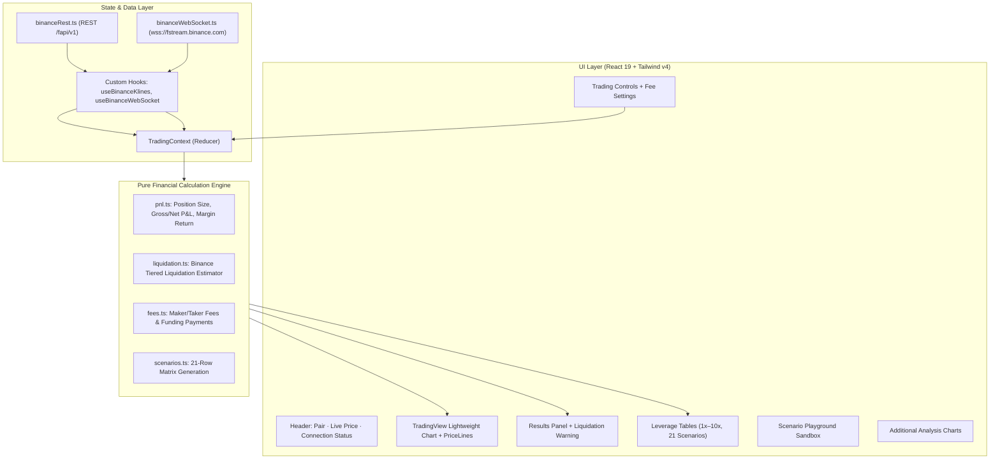

# Future Trading Analyzer — Binance BTCUSDT

A high-performance, beginner-friendly **Crypto Futures Trading Analyzer** built with React 19, TypeScript, Tailwind CSS v4, and TradingView Lightweight Charts.

The platform visualizes the relationship between **Initial Margin**, **Leverage**, **Position Sizing**, **Price Moves (±1% to ±10%)**, **Gross/Net P&L**, and **Liquidation Risk** using real-time and historical Binance Futures market data.

> [!NOTE]
> **Educational & Analysis Tool Only**: This application does not predict future prices, provide financial advice, execute trades, or connect directly to user trading accounts.

---

## Features

- **Interactive Futures Calculator**:
  - Configurable Initial Margin (default 10 USDT), Leverage (1× to 125×), Direction (LONG/SHORT), and Entry Price.
  - Isolated vs. Cross margin modes with educational risk explanations.
  - Automatic computation of Position Size, Notional Value, Gross P&L, Return on Margin (%), Fees, and Remaining Margin Equity.
- **Binance Candlestick & Volume Charts**:
  - Real-time candlesticks and volume histograms powered by TradingView Lightweight Charts.
  - 15 Binance intervals supported (`1m`, `3m`, `5m`, `15m`, `30m`, `1h`, `2h`, `4h`, `6h`, `8h`, `12h`, `1d`, `3d`, `1w`, `1M`).
  - Interactive crosshair with detailed OHLCV + quote volume + trades inspection.
  - Live price stream and candle updates via Binance Futures WebSockets (`wss://fstream.binance.com`).
  - Timezone selector across 12 global regions.
- **Visual Price-Movement Analyzer**:
  - Overlays the Entry Price line alongside dynamic exit price lines for ±1% through ±10% price fluctuations.
  - Color-coded profit (green) and loss (red) levels with exact P&L and return labels.
  - Toggle individual percentage lines on or off directly on the chart.
- **Leverage Comparison Tables**:
  - 10 distinct dynamic tables covering 1× through 10× leverage.
  - Each table models all 21 price-movement scenarios (−10% to +10% in 1% increments) for both LONG and SHORT outcomes.
  - Export individual tables or all 210 scenarios combined directly to CSV.
- **Dedicated Scenario Playground**:
  - Independent sandbox with real-time reactive sliders and custom percentage inputs.
  - Quick-view scenario comparison cards.
  - Tiered liquidation risk buffers and alerts.
- **Additional Analytical Views**:
  - Alternative charts: Closing Price Line Chart, Standalone Volume Histogram, Price Change Percentage Chart, P&L Sensitivity Analysis across leverage, and Long vs. Short outcome comparisons.
- **Tier-Aware Liquidation Risk Modeling**:
  - Liquidation estimates respect Binance USDS-M tiered Maintenance Margin Requirement (MMR) brackets and cumulative deduction amounts.

---

## Architecture Overview



---

## Tech Stack

- **Framework**: React 19 + TypeScript 6 + Vite 8
- **Charting**: TradingView Lightweight Charts (`lightweight-charts` v5)
- **Styling**: Tailwind CSS v4 (`@tailwindcss/vite`)
- **Data Export**: Papa Parse (`papaparse`)
- **Testing**: Vitest + React Testing Library + JSDOM (159 tests)
- **Data Source**: Binance USDS-Margined Futures public REST API & WebSockets

---

## Prerequisites & Installation

### Prerequisites
- Node.js `v20.19.0` or `>=22.12.0` (Node `v22.16.0+` recommended)
- npm `10.8.0+`

### Installation

```bash
git clone https://github.com/Vishaldonda/Future-Trading-Analyzer.git
cd "Future Trading Analyzer"

npm install
```

---

## Running the Application

### Development Server
Starts the Vite development server with configured proxy for `/binance-api` -> `https://fapi.binance.com`:

```bash
npm run dev
```
Open [http://localhost:5173](http://localhost:5173) in your browser.

### Run Automated Tests
Runs all 159 unit and integration tests:

```bash
npm test
```

### Production Build
Builds the type-checked, minified production bundle in `dist/`:

```bash
npm run build
```

Preview the production build locally:
```bash
npm run preview
```

---

## API & Data Limitations

1. **Public Market Data**: All endpoints used are public. No Binance API keys are required.
2. **CORS Configuration**: The local development server uses Vite's proxy (`/binance-api` -> `https://fapi.binance.com`). When deploying to production, configure a reverse proxy (e.g., NGINX, Cloudflare Workers, or Vercel rewrites) to prevent browser CORS blocks.
3. **1-Second Candles**: Binance REST does not store historical 1-second klines; 1s data is supported only through live WebSocket streams.
4. **Liquidation Accuracy**: Liquidation calculations use Binance's official maintenance margin bracket schedule for BTCUSDT. Actual exchange liquidation prices may vary slightly due to insurance fund clearance fees and account-level margin configuration.

---

## Development Context

For session history, design decisions, resolved issues, and planned enhancements, consult [DEV_LOG.md](DEV_LOG.md).
